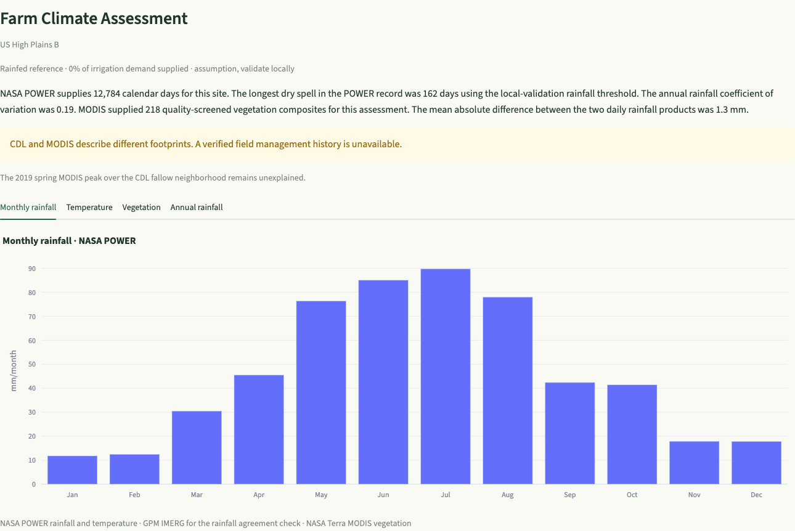
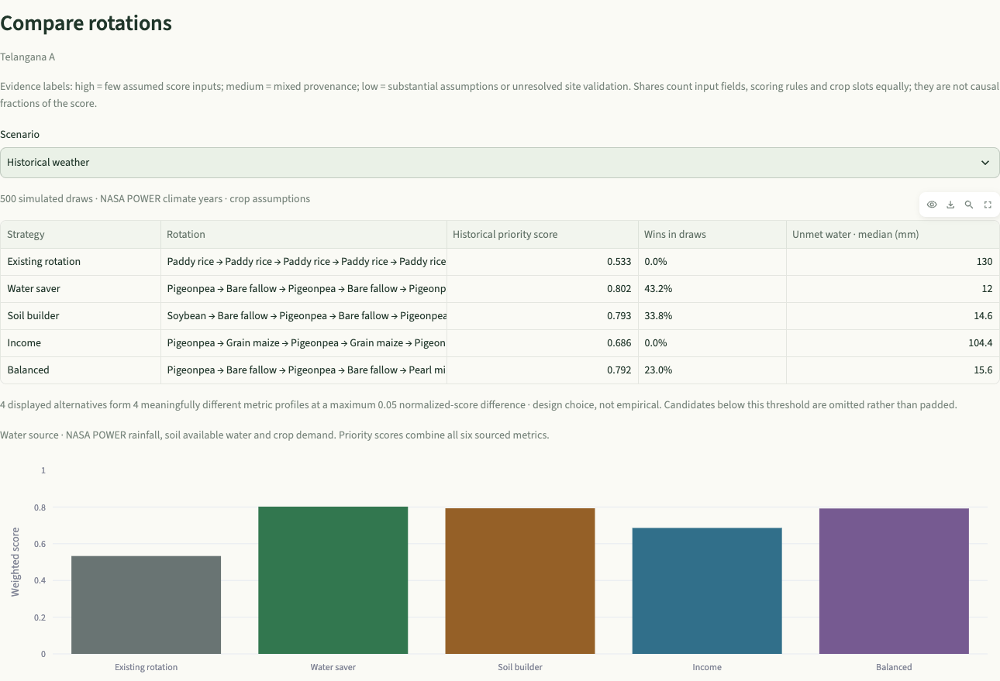
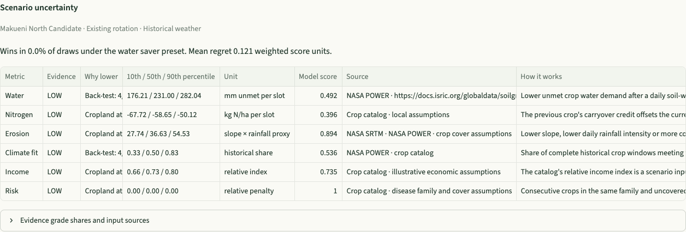
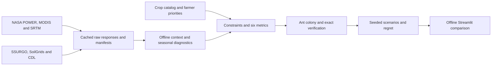

# CropSwarm

CropSwarm is an offline decision-support demo for comparing crop rotations at three illustrative farms in Kansas, Telangana and Makueni. It combines NASA weather, vegetation and terrain data with soil estimates, crop parameters and farmer priorities to show a baseline and alternatives with evidence, trade-offs and modeled uncertainty. The farmer decides; validate every input locally before changing a rotation.

## Seven key results

1. Each farm shows its configured baseline and four alternatives with distinct metric profiles, reasons, benefits, risks and information gaps.
2. NASA POWER supplies 1991–2025 daily weather for all three sites. The long-record consistency check uses 2001–2024 Terra MODIS composites. [Coverage and results](docs/backtest.md#p19-long-record-nasa-consistency-check)
3. Six source-tagged metrics cover water, nitrogen, erosion, climate fit, relative income and risk. [Scoring](docs/scoring.md)
4. Exact enumeration evaluated 168 canonical rotations in Kansas, 211,394 in Telangana and 16,914 in Makueni over three modeled years. Whole-year cyclic shifts count once. [Verification](docs/optimizer.md)
5. For the nominal scoring benchmark, single-run ant colony search matched the exact optimum in 21–30 of 30 trials per farm and preset. Taking the highest score from five independent runs matched in all 360 trials. [Gaps](docs/optimizer.md)
6. Seeded scenario draws show score ranges, win percentages, regret and sensitivity; these ranges describe model assumptions. [Method](docs/scoring.md)
7. The baseline flags remain visible: the spring NDVI peak over Kansas CDL-mapped fallow remains unexplained, Telangana repeats paddy and its second season is tentative, and Makueni cropland is unverified. [Site caveats](docs/decisions.md)

Evidence grades expose how each modeled metric depends on NASA, external, literature and assumed inputs. All displayed strategies currently have a **low overall evidence label** because key crop and management inputs remain assumptions. [Method and limits](docs/evidence_grades.md)

## Screenshots





[All 30 screenshots](docs/screenshots/README.md)

## Run the demo

```sh
python3.12 -m venv .venv
. .venv/bin/activate
python -m pip install -r requirements.txt
python -m streamlit run app/main.py
python -m pytest -q
```

The app runs offline from checked-in files in `data/processed/`. The pin map uses bundled Natural Earth land outlines. [Runtime data and screenshot instructions](docs/portability.md) · [Evidence ledger](docs/evidence_ledger.md) · [Scoring literature cross-check](docs/literature_check.md) · [Telangana and Makueni literature benchmarks](docs/literature_check_p45.md) · [Regional scoring what-if](docs/regional_scoring_variants.md) · [Kansas literature-informed what-if](docs/literature_variant.md) · [Smooth climate-fit what-if](docs/smooth_climate_fit.md) · [Consensus shortlist check](docs/consensus_shortlist.md) · [Historical back-test](docs/backtest.md) · [Learned climate-yield check](docs/ml_model.md) · [Weather-shift robustness check (P16)](docs/stress_test.md) · [Preliminary risk-aware picks under assumption changes (P28b)](docs/robust_optimization.md#p28b-feasible-tail-and-draw-count-check) · [Submission summary](docs/submission_summary.md) · [What to check first](docs/sensitivity.md) · [Opportunity windows](docs/opportunity_windows.md)

Under **Farm priorities**, use **Download brief** to print or share the reference shortlist for the selected farm and named preset. [All 12 HTML and PDF briefs](docs/briefs/README.md)

## Architecture



## Evidence and limitations

- **Tier 1** uses NASA POWER daily weather and precipitation, Terra MODIS vegetation composites, SRTM terrain and ISRIC SoilGrids model estimates. POWER root-zone wetness is modelled. MODIS vegetation cannot identify exact crops or farmer practices at these footprints. The satellites used here do not directly measure soil nitrogen or organic carbon.
- **Tier 2** adds USDA SSURGO soil map units and CDL crop history in Kansas. US High Plains B is modeled as rainfed with irrigation supply fraction 0.0. The spring 2019 MODIS NDVI peak over the CDL fallow neighborhood remains unexplained. Makueni cropland remains unverified. Telangana's second season is tentative and its repeated-paddy baseline retains its violation flag.
- Crop calendars, irrigation share and market indices are illustrative. Soil water uses the upper 30 cm. The erosion index is a simplified proxy and relative income is an assumption. Scenario intervals describe the modeled draws. [Decisions and validity](docs/decisions.md) · [Scoring](docs/scoring.md)

## Optimizer verification

The headline ant colony results above use nominal scores. The preliminary P28b picks use the tested assumption ranges. Across 128, 256 and 512 draws, the same rotation appeared in 8 of 12 farm–preset combinations for expected score, 6 of 12 for conditional CVaR and 2 of 12 for minimax regret. [Risk-aware exact and swarm results](docs/robust_optimization.md#p28b-feasible-tail-and-draw-count-check)

In the pooled USDA district holdout for Kansas winter wheat, RMSE was 11.202 bu/acre for the county-mean baseline, 10.758 for the trend baseline, 9.562 for ridge and 9.034 for random forest. The check describes weather–yield associations in Kansas county averages. Rotation quality still needs field evidence. The India replication stopped at crop selection because the kharif rice archive lacks the required irrigation evidence. [Kansas district results](docs/ml_model.md#results-by-subset-and-split) · [India archive screen](docs/ml_model.md#p31-india-replication-archive-screen)

The local recalibration study compares each method with both the local trend and the local county mean. A trend fitted to only a few years is a weak baseline. At three years, no method beat the county mean with a paired interval excluding zero. Local ridge first did so at five years in Oklahoma and twelve in Nebraska. [P37 and P37b results](docs/ml_model.md#p37-local-yield-recalibration)

## Rebuild from cached evidence

```sh
python -m src.context --offline
python -m src.data_pipeline
python -m src.diagnostics
python -m src.farm_validity
python -m src.optimizer
python -m src.uncertainty
python -m src.backtest
python -m src.data_pipeline --long-record
python -m src.nasa_consistency
python -m src.yield_backtest
python -m src.stress_test
python -m src.stress_margins
python -m src.tie_diagnosis
python -m src.sensitivity
python -m src.robust_optimization
python -m src.robust_stability
python -m src.opportunity_windows
python -m src.app_assets
```

Live requests belong in precompute commands. Use `python -m src.data_pipeline --fetch` to resume missing NASA chunks. Live soil precompute uses the PROJ command `proj`. [NASA pipeline and coverage](docs/data_pipeline.md) · [Crop catalog sources](docs/crops.md) · [API status](docs/api_status.md)

## Deployment and submission

Use the Dockerfile for a Hugging Face Docker Space or select `app/main.py` in Streamlit Community Cloud. [Deployment checks](docs/deployment.md) · [Demo script and slide outline](docs/demo.md)

The processed NASA inputs are POWER weather, Terra MODIS NDVI, MODIS land cover and SRTM terrain. GPM IMERG via POWER is used only for the rainfall agreement diagnostic on matching UTC days. SMAP, ECOSTRESS, GRACE, Landsat and ERA5 were unused. [Dataset roles](docs/submission_summary.md#data-actually-used) · [Final consistency audit](docs/p30_audit.md)
