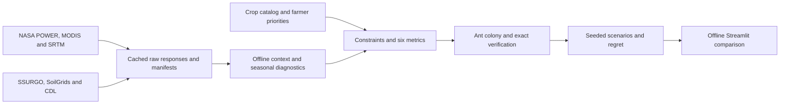

# CropSwarm

CropSwarm helps farmers compare crop rotations under different weather and irrigation assumptions. The offline demo covers three illustrative sites and displays the existing rotation alongside four distinct alternatives, evidence, trade-offs, modeled ranges and wins across scenario draws. The farmer decides. Validate inputs locally before changing a rotation.

## Run the demo

```sh
python -m pip install -r requirements.txt
python -m streamlit run app/main.py
python -m pytest -q
```

The app reads checked-in files in `data/processed/`. It needs no Earthdata credentials or live data services. The pin map uses bundled Natural Earth land outlines.

## Architecture



## Evidence and limitations

- **Tier 1** uses NASA POWER daily weather and precipitation, Terra MODIS vegetation composites, SRTM terrain and ISRIC SoilGrids model estimates. POWER root-zone wetness is modelled. MODIS vegetation cannot identify exact crops or farmer practices at these footprints. The satellites used here do not directly measure soil nitrogen or organic carbon.
- **Tier 2** adds USDA SSURGO soil map units and CDL crop history in Kansas. Field groundwater trends and irrigation access remain unverified. The Makueni point is flagged `cropland unverified`. Telangana has a tentative second window and its repeated-paddy baseline retains its violation flag.
- Crop calendars, irrigation share and market indices are illustrative. Soil water uses the upper 30 cm. The erosion index is a simplified proxy and relative income is an assumption. Scenario intervals describe the modeled draws. [Decisions and validity](docs/decisions.md) · [Scoring](docs/scoring.md)

## Optimizer verification

All three sites fit a three-year horizon. Exact enumeration evaluated 504, 633,998 and 50,658 feasible rotations in Kansas, Telangana and Makueni, respectively. Across 30 seeds per site and preset, ACO hit the exact optimum in 21–30 runs. Every site and preset had at least one exact hit. [Verification, runtimes and gaps](docs/optimizer.md)

## Rebuild from cached evidence

```sh
python -m src.context --offline
python -m src.data_pipeline
python -m src.diagnostics
python -m src.farm_validity
python -m src.optimizer
python -m src.uncertainty
python -m src.app_assets
```

Live requests belong in precompute commands. Use `python -m src.data_pipeline --fetch` to resume missing NASA chunks. Live soil precompute uses the PROJ command `proj`. [NASA pipeline and coverage](docs/data_pipeline.md) · [Crop catalog sources](docs/crops.md) · [API status](docs/api_status.md)

## Deployment and submission

Use the Dockerfile for a Hugging Face Docker Space or select `app/main.py` in Streamlit Community Cloud. [Deployment checks](docs/deployment.md) · [Demo script and slide outline](docs/demo.md)

The next version would validate more sites and explore SMAP soil moisture, ECOSTRESS thermal observations, GRACE regional water storage and finer Landsat field context. These missions are outside the current pipeline.
