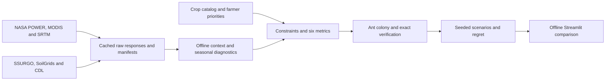

# CropSwarm

CropSwarm is an offline decision-support demo for comparing crop rotations at three illustrative farms in Kansas, Telangana and Makueni. It combines NASA weather, vegetation and terrain data with soil estimates, crop parameters and farmer priorities to show a baseline and alternatives with evidence, trade-offs and modeled uncertainty. The farmer decides; validate every input locally before changing a rotation.

## Seven key results

1. Each farm shows its existing baseline and four alternatives with distinct metric profiles, reasons, benefits, risks and information gaps.
2. NASA POWER supplies 1991–2025 daily weather for all three sites; Terra MODIS supplies 2015–2024 vegetation composites. [Coverage](docs/data_pipeline.md)
3. Six source-tagged metrics cover water, nitrogen, erosion, climate fit, relative income and risk. [Scoring](docs/scoring.md)
4. Exact enumeration evaluated 168 canonical rotations in Kansas, 211,394 in Telangana and 16,914 in Makueni over three years. Whole-year cyclic shifts count once. [Verification](docs/optimizer.md)
5. Across 30 seeded trials per farm and preset, a single ant-colony run found the exact optimum 21–30 times; best-of-five found it 29–30 times. [Gaps](docs/optimizer.md)
6. Seeded scenario draws show score ranges, win percentages, regret and sensitivity; these ranges describe model assumptions. [Method](docs/scoring.md)
7. The baseline flags remain visible: Kansas fallow and spring NDVI disagree, Telangana repeats paddy and its second season is tentative, and Makueni cropland is unverified. [Validity](docs/decisions.md)

## Screenshots


[All nine screenshots](docs/screenshots/README.md)

## Run the demo

```sh
python3.12 -m venv .venv
. .venv/bin/activate
python -m pip install -r requirements.txt
python -m streamlit run app/main.py
python -m pytest -q
```

The app runs offline from checked-in files in `data/processed/`. The pin map uses bundled Natural Earth land outlines. [Runtime data and screenshot instructions](docs/portability.md) · [Historical back-test](docs/backtest.md) · [Robustness check](docs/stress_test.md) · [Submission summary](docs/submission_summary.md)

## Architecture



## Evidence and limitations

- **Tier 1** uses NASA POWER daily weather and precipitation, Terra MODIS vegetation composites, SRTM terrain and ISRIC SoilGrids model estimates. POWER root-zone wetness is modelled. MODIS vegetation cannot identify exact crops or farmer practices at these footprints. The satellites used here do not directly measure soil nitrogen or organic carbon.
- **Tier 2** adds USDA SSURGO soil map units and CDL crop history in Kansas. US High Plains B is modeled as rainfed with irrigation supply fraction 0.0. The spring 2019 MODIS NDVI peak over the CDL fallow neighborhood remains unexplained. Makueni cropland remains unverified. Telangana's second season is tentative and its repeated-paddy baseline retains its violation flag.
- Crop calendars, irrigation share and market indices are illustrative. Soil water uses the upper 30 cm. The erosion index is a simplified proxy and relative income is an assumption. Scenario intervals describe the modeled draws. [Decisions and validity](docs/decisions.md) · [Scoring](docs/scoring.md)

## Optimizer verification

All three sites fit a three-year horizon. Exact enumeration evaluated 168, 211,394 and 16,914 canonical rotations in Kansas, Telangana and Makueni, respectively. Across 30 trials per farm and preset, a single ACO run reached the exact optimum 21–30 times and best-of-five reached it 29–30 times. [Verification, seeds and optimality gaps](docs/optimizer.md)

## Rebuild from cached evidence

```sh
python -m src.context --offline
python -m src.data_pipeline
python -m src.diagnostics
python -m src.farm_validity
python -m src.optimizer
python -m src.uncertainty
python -m src.backtest
python -m src.stress_test
python -m src.stress_margins
python -m src.tie_diagnosis
python -m src.app_assets
```

Live requests belong in precompute commands. Use `python -m src.data_pipeline --fetch` to resume missing NASA chunks. Live soil precompute uses the PROJ command `proj`. [NASA pipeline and coverage](docs/data_pipeline.md) · [Crop catalog sources](docs/crops.md) · [API status](docs/api_status.md)

## Deployment and submission

Use the Dockerfile for a Hugging Face Docker Space or select `app/main.py` in Streamlit Community Cloud. [Deployment checks](docs/deployment.md) · [Demo script and slide outline](docs/demo.md)

The next version would validate more sites and explore SMAP soil moisture, ECOSTRESS thermal observations, GRACE regional water storage and finer Landsat field context. These missions are outside the current pipeline.
